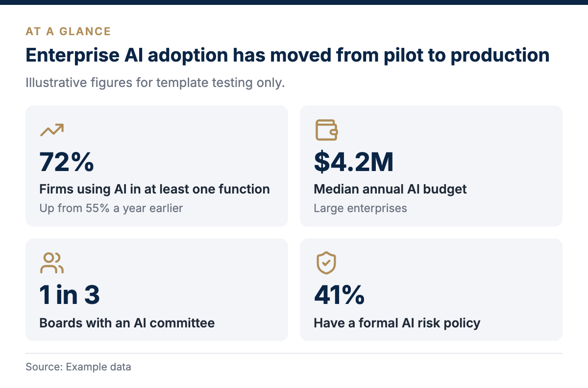
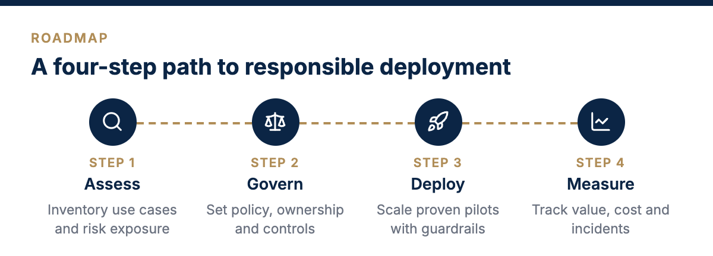

# newsletter-1

An on-demand newsletter pipeline for executives. You give a topic and the recipients. The system researches the topic, writes a short, formal newsletter with two infographics, builds an email that displays properly in Gmail, and sends it from your Gmail account.

It follows the **WAT framework** (Workflows, Agents, Tools) described in [CLAUDE.md](CLAUDE.md):

- **Workflows** (`workflows/`): plain-language instructions. This project's is [workflows/newsletter.md](workflows/newsletter.md).
- **Agent:** Claude Code reads the workflow, writes the content, runs the tools in order and asks for your approval before anything is sent.
- **Tools** (`tools/`): Python scripts that do the actual work in a repeatable way.

## How an issue is made

| Step | What happens | Tool |
|---|---|---|
| 1. Research | Searches the web for the topic and 2–3 angles, and saves the sources | `tools/research_topic.py` (Tavily API) |
| 2. Write | Claude writes the issue from the research: headline, executive summary, 2–3 sections, bottom line, sources | done by the agent |
| 3. Infographics | Two infographics built from templates, using only figures from the research | `tools/render_infographic.py` |
| 4. Build | Email-safe HTML, a browser preview, an A4 PDF, and a word-count check | `tools/build_newsletter_html.py` |
| 5. Test send | Sends the issue to your own Gmail address for review | `tools/send_gmail.py` |
| 6. Send | After you approve, sends it to the recipients you named for this issue. Each recipient gets their own copy. | `tools/send_gmail.py --to "..."` |

### Editorial rules

- Written for executives, in a formal tone.
- The newsletter name is short and derived from the topic.
- The written text is at most one A4 page (550 words). The two infographics come on top.
- Every figure must come from the research. Sources are listed at the end.

### Infographic templates

Four templates share one navy-and-gold executive style and use free [Lucide](https://lucide.dev/icons) icons (ISC license):

| Template | Use for |
|---|---|
| `key_figures` | 2–4 headline statistics |
| `bar_chart` | comparing values across categories |
| `process` | 3–5 steps, phases or a timeline |
| `comparison` | two options side by side |

Example specs are in [tools/examples/](tools/examples/).




*Figures in the examples are illustrative only.*

## Setup

Requirements: macOS with Homebrew, Python 3.14 and Google Chrome (used to render the infographics).

```bash
brew install python@3.14
/opt/homebrew/bin/python3.14 -m venv .venv
.venv/bin/pip install -r requirements.txt
cp .env.example .env
```

Then fill in `.env`:

| Variable | What it is |
|---|---|
| `TAVILY_API_KEY` | Free key from [tavily.com](https://tavily.com) (about 1,000 credits a month) |
| `GMAIL_SENDER` | The Gmail address the newsletter is sent from |
| `GMAIL_SENDER_NAME` | Optional display name for the sender |

### Gmail API access

1. In [Google Cloud Console](https://console.cloud.google.com), create a project.
2. Under **APIs & Services → Library**, enable the **Gmail API**.
3. Under **OAuth consent screen**, choose External and add your Gmail address as a test user.
4. Under **Credentials → Create credentials → OAuth client ID**, choose **Desktop app** and download the JSON file.
5. Save it in the project folder as `credentials.json`.

The first send opens a browser so you can approve access. `token.json` is then saved and reused. The app asks only for permission to send email.

## Usage

Open the project in Claude Code and ask for an issue, for example:

> Make a newsletter about the EU AI Act and send it to a@example.com and b@example.com.

Claude follows [workflows/newsletter.md](workflows/newsletter.md). It shows you the preview, sends a test to your own address, and sends to the recipients only after you approve.

The tools can also be run by hand. Run each one with `--help` for details:

```bash
.venv/bin/python tools/research_topic.py "EU AI Act" --query "enforcement timeline"
.venv/bin/python tools/render_infographic.py tools/examples/key_figures.json
.venv/bin/python tools/build_newsletter_html.py tools/examples/content.json
.venv/bin/python tools/send_gmail.py .tmp/issues/<issue>/manifest.json --dry-run
```

## Project layout

```
CLAUDE.md              Agent instructions (WAT framework)
workflows/             Step-by-step instructions for the agent
tools/                 Python scripts
  templates/           Infographic and email HTML templates
  examples/            Example infographic specs and newsletter content
docs/images/           Images used in this README
.tmp/                  Research, infographics and built issues (disposable, not in git)
.env                   Your keys and settings (not in git)
credentials.json       Gmail OAuth client (not in git)
token.json             Saved Gmail sign-in (not in git)
```

## Limits and costs

- **Tavily:** the free tier gives about 1,000 credits a month. An issue uses about 6–8 credits.
- **Gmail:** a personal account can send to about 500 recipients a day.
- **Infographics and writing:** free. Templates render locally and Claude writes the text in the chat.
